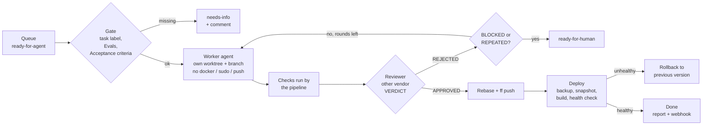

# agent-issue-pipeline


An issue-to-deploy pipeline for coding agents. Coding agents write the code; the pipeline decides what counts as done.

It takes one issue at a time from a queue and runs it through these steps:

1. **Gate.** Only well-specified issues get in.
2. **Worker.** A coding agent (Claude Code by default) implements the issue in its own git worktree.
3. **Checks.** The pipeline runs the tests itself.
4. **Review.** An agent from a different vendor (Codex by default) reviews the diff.
5. **Integrate.** The pipeline merges the change.
6. **Deploy.** It deploys with a health check and rolls back automatically if the check fails.

People decide what to build and approve what the agents could not settle. The agents do the rest.

This is a cleaned-up, generic version of a pipeline I run every day on personal projects. Most of the failure modes listed below happened in real use.

> **PT-BR:** pipeline que leva uma issue até o deploy usando agentes de código. Ela só aceita issues bem especificadas, roda o worker isolado numa worktree, executa os testes ela mesma, pede revisão a um agente de outro fornecedor e faz deploy com rollback automático. As pessoas decidem o que construir e o que fazer quando a pipeline trava.

## How an issue moves



**Benchmark, 20 issues with hidden acceptance tests:** in every run, all underspecified and impossible issues were stopped or sent to a human. With the current reviewer: 19/20, 1 false approval, 0 false rejections. The first reviewer prompt had 0 false approvals but 3 false rejections. Details in [Benchmark](#benchmark).

| Step | What the agent does | Who decides |
|---|---|---|
| Gate | nothing yet | issues without `## Evals` and `## Acceptance criteria` never reach an agent |
| Worker | implements and commits in an isolated worktree, one branch per issue | it cannot run docker, sudo or `git push` |
| Checks | — | the pipeline runs tests, lint and build; the agent saying "tests pass" counts for nothing |
| Review | a second agent from another vendor reads the diff and the real check output | strict verdict rule: only CRITICAL/HIGH findings or unmet criteria reject |
| Integrate | — | rebase plus fast-forward push; anything unusual stops and goes to a human |
| Deploy | — | a failed build or health check never counts as success, and the pipeline rolls back on its own |

## Try it in 30 seconds (no API keys)

The demo replaces both agents with deterministic mocks.

```bash
python3 examples/setup_demo.py /tmp/demo
python3 pipeline.py --config /tmp/demo/pipeline.toml --all
```

```text
DEMO-1 started (default model) in <demo>/.pipeline/wt/DEMO-1
DEMO-1 round 1: checks pass, mock reviewer: APPROVED
DEMO-1 finished: approved and merged (`8517f21`); deployed, health check ok
DEMO-2 stopped at the gate: ['section `## Evals` with content', 'section `## Acceptance criteria` with content']
DEMO-3 started (default model) in <demo>/.pipeline/wt/DEMO-3
DEMO-3 finished: escalated after 1 round(s)
DEMO-4 started (default model) in <demo>/.pipeline/wt/DEMO-4
DEMO-4 round 1: checks fail, mock reviewer: REJECTED
DEMO-4 round 2: checks pass, mock reviewer: APPROVED
DEMO-4 finished: approved and merged (`a778210`); deployed, health check ok
```

The four demo issues cover four paths:

- **DEMO-1** is the happy path.
- **DEMO-2** is too vague and is stopped at the gate.
- **DEMO-3** has a spec the worker cannot meet. The worker says so with `BLOCKED:` and the issue goes to a human without spending a review.
- **DEMO-4** ships a bug in round 1. The real test output and the review go back to the worker, which fixes the bug in round 2.

`tests/test_pipeline.py` runs this same demo end to end in CI.

## Running it with real agents

1. Copy `pipeline.example.toml` to `pipeline.toml` and point `repo.path` at a clone of your project.
2. Write your issues as Markdown files in `issues/` (see `tracker.py` for the format). Add the `task` and `ready-for-agent` labels, plus the `## Evals` and `## Acceptance criteria` sections.
3. Run `python3 pipeline.py` for a polling loop, `--once` for a single issue, `--issue ID` for a specific issue, or `--dry-run` to run only the gate.

To run it as a service, a systemd user unit with `Restart=on-failure` is enough. The pipeline handles exhausted quota and expired agent logins on its own: it pauses, sends one webhook message and retries every 30 minutes.

The tracker is a folder of Markdown files on purpose. Replacing it with GitHub Issues, Linear or Jira means implementing five methods: `list`, `get`, `set_state`, `label` and `comment`.

## Failure modes it handles

Most rows come from incidents in real use. The rest are guards the design needed from day one.

| Failure | What happened | What the pipeline does | Covered by |
|---|---|---|---|
| Vague issue | The agent fills the gaps with guesses, and the review cannot tell right from wrong | The gate requires non-empty evals and acceptance criteria; otherwise `needs-info` plus a comment listing what is missing | `test_gate`, DEMO-2 |
| Impossible spec | The worker faked a field that the external API did not provide | The worker must write `BLOCKED: <reason>`; the pipeline escalates immediately, even if the reviewer approved the rest | `test_marks`, DEMO-3 |
| `main` moved meanwhile | A rebase can apply cleanly and still break behaviour | After a rebase that changed anything, the checks run again before the push | — |
| Resumed issue | A pause in the middle of an issue must not discard work | An existing worktree or branch for the issue is reused, never reset | — |
| Review loop | One issue was rejected 4 times for the same finding, burning quota | The reviewer marks unresolved findings `REPEATED:`; one repeat escalates to a human | `test_marks` |
| Worker commits nothing | Checks and review ran on an empty diff | An empty diff skips checks and review and returns to the worker | e2e |
| "Tests pass" (they didn't) | The agent's summary disagreed with reality | The pipeline runs the checks itself, and failing checks force `REJECTED` whatever the reviewer says | DEMO-4 |
| Reviewer ignores the format or hangs | No parseable verdict | The last `VERDICT:` line wins; with no verdict or a timeout, a fallback reviewer runs, and a stale result file from the first reviewer is never read | `test_verdict_takes_the_last_line`, `test_reviewer_fallback_ignores_stale_result` |
| Build fails during deploy | The old container stayed up and passed the health check, which looked like success | A failed build is a failure; production stays on the previous version | `test_deploy_build_failure_keeps_old_version` |
| New version unhealthy | Bad migration, crash on start, or a half-applied `up` | Backup and snapshot first, then automatic rollback; a rollback that fails is reported loudly, never as success | `test_deploy_rolls_back_on_bad_health_check`, `test_deploy_failed_up_rolls_back_and_failed_rollback_is_reported` |
| Main clone was dirty | Someone was editing on the deploy machine | The push still happens, but the deploy stops and is handed to a human | — |
| Quota or login expired | The agent CLI exited in the middle of an issue | Pause and retry every 30 min with a single notification; the issue resumes as In Progress | — |

## Benchmark

`bench/` runs the pipeline over 20 issues with a known right answer and scores what it did.

- **Target project:** `brdocs`, a tiny standard-library Python package for Brazilian documents, money and dates.
- **Issues:**
  - 8 feasible (CNPJ, NF-e access key, PIS, dates, money formatting...);
  - 3 hard, where the naive answer is wrong (the 2026 alphanumeric CNPJ, splitting money into installments to the cent, Easter-based holidays);
  - 3 impossible or contradictory (live government data in a project that forbids network access, two acceptance criteria that cannot both hold);
  - 6 underspecified, which should never reach an agent.
- **Hidden tests:** for every solvable issue, a hidden acceptance test that the agents never see runs against what was actually merged. The same hidden tests run against the worker's branch when nothing was merged, which separates a correct rejection from a false one.
- **Two modes, same worker (Claude Code, Sonnet):**
  - `review`: Codex reviews every diff;
  - `no-review`: the reviewer is replaced by "approve when the pipeline's own checks pass".
- **Two versions, one run of each mode per version:**
  - **v1** is the first review prompt;
  - **v2** adds the two reviewer fixes that v1 motivated (below).

| | Codex review, v1 | Codex review, v2 | Checks only, v2 |
|---|---|---|---|
| Correct outcomes | 17/20 | **19/20** | **19/20** |
| Feasible: merged, hidden tests pass | 6/8 | 8/8 | 8/8 |
| Hard: merged, hidden tests pass | 2/3 | 2/3 | 2/3 |
| Impossible: handed to a human, nothing merged | 3/3 | 3/3 | 3/3 |
| Underspecified: stopped at the gate | 6/6 | 6/6 | 6/6 |
| False approvals (merged, hidden test fails) | **0** | **1** | **1** |
| False rejections (not merged, branch passes hidden test) | **3** | **0** | **0** |
| Agent time | 10.5 min | 8.8 min | 5.0 min |
| Tokens | 4.3 M | 3.2 M | 3.0 M |
| Cost reported by the Claude CLI (Codex not included) | US$ 2.61 | US$ 2.09 | US$ 1.94 |

The checks-only mode scored the same in v1: 19/20, the same single false approval, US$ 1.89. Per-issue results and every run are in [`bench/RESULTS.md`](bench/RESULTS.md), with the raw data in `bench/results/`. The reviews, check outputs, worker answers and diffs behind the cases below are in [`bench/evidence/`](bench/evidence/). Hidden tests run on the exact commit each issue pushed, or on the worker's branch when nothing was merged, so one issue's result never depends on another's.

**What it says:**

1. **The gate and the `BLOCKED:` contract did the safety work.** In all four runs, all 6 underspecified issues stopped before any agent ran. All 3 impossible ones went to a human, with the worker saying why (for example, that two acceptance criteria contradict each other for the same function and input).
2. **v1: the reviewer prevented the only bad merge, at the price of three false blocks.** On the installment splitter, the worker produced code that accepted `Decimal("1.500")`, which the issue says must be rejected for having more than 2 decimal places. Without review it was merged. With review, Codex flagged it in round 1 and the worker fixed it. The same reviewer also blocked three changes whose final branch passes the hidden tests. It cannot run code, and:
   - it miscomputed a check digit (a weighted sum of 139 instead of 119);
   - it claimed that a test failed while `checks.txt` showed the suite passing;
   - after the real fix, it kept escalating the splitter into edge cases such as `Decimal("1E+1000000")`.

   It also approved code that called the central bank API on the impossible SELIC issue, because it never saw the project rule against network access. The worker's `BLOCKED:` line is what stopped that merge.
3. **v2: the fixes removed every false block, and the catch went with them.**
   - **The fixes:** the reviewer now receives the repository's `CLAUDE.md`/`AGENTS.md` as `PROJECT_RULES.md`. The review prompt now treats `checks.txt` as ground truth, and findings it cannot verify stay MEDIUM, which does not reject.
   - **The result:** false rejections went from 3 to 0, and agent time fell 16%. But on the splitter Codex raised a different HIGH finding (results depending on the active `Decimal` context), the worker fixed it, and the `1.500` gap was merged, exactly as without review.
   - **Why the catch did not repeat is not something one run can show.** In v1 the gap was caught by a rejection with MEDIUM findings only, justified as an unmet acceptance criterion, which the verdict rule allows. In v2 the reviewer spent its rejection on another problem and approved the fix.
4. **So, on this set, the two prompts traded errors rather than removing them.** v1 blocked 3 correct changes and let no bad change through. v2 blocked none and let 1 through, the same one the checks-only mode let through. With one run per configuration this cannot be attributed to the prompt alone. Run-to-run variation is just as plausible, and separating the two needs repeated runs and a set where review has more to find (large diffs, missing tests, security-sensitive code).

**Limits:**

- **Small and narrow.** n = 20 small, well-specified Python tasks, one worker model and a single run per mode and version, so there are no error bars.
- **Near the ceiling.** A strong worker with real tests got 10 of 11 solvable issues right on its own, so the set has little room to show where review pays off. Every review effect above rests on one or a few issues.
- **One judgement call in the gold set.** BENCH-10's "more than 2 decimal places" is read by exponent, so `Decimal("1.500")` must be rejected. The v1 reviewer read it the same way. The `1.500` case was added to the hidden test after a review pointed out the gap, and v1 was re-scored with `--score-only`, without re-running the agents. v2 ran with the final hidden tests.
- **Reviewer configuration.** Codex ran with its default settings through `codex exec`.

To reproduce:

```bash
python bench/run_bench.py --mode review --tag my-run   # or --mode no-review
python bench/run_bench.py --mode mock         # the harness and the hidden tests, with no agents (CI runs this)
```

## Design decisions and trade-offs

- **A reviewer from a different vendor.** The same model reviewing its own diff tends to agree with itself, and a fallback avoids depending on a single provider. The benchmark above is a fair warning: a reviewer that cannot execute code needs the test output and the project rules in front of it, and its unverified claims should not block a merge.
- **The reviewer sees files, not the repo.** It gets `REVIEW.md`, `diff.patch` and `checks.txt` in an empty folder. It cannot edit the change, and it judges real test output rather than the worker's claims.
- **A strict verdict rule.** Only CRITICAL/HIGH findings or unmet criteria reject a change. MEDIUM/LOW findings become follow-ups. Without this rule, reviewers reject on taste and the loop never converges.
- **One issue at a time.** Throughput is lower, but there are no merge races, quota use is predictable, and each report reads as a single story.
- **Plain files and git.** There is no database, no queue server and no framework. The whole orchestrator fits in one file you can read in one sitting.

## Limitations

- **A worktree is not a sandbox.** Disallowing `docker`, `sudo` and `git push` is a tool-level policy, not process isolation. Run the worker as a user without deploy credentials, or inside a container or VM, and keep secrets out of its environment. The pipeline holds the push and deploy steps for this reason.
- **The deploy step runs shell commands from your config**, with the same trust level as a Makefile.
- **Cost accounting is partial.** Dollars come from Claude Code's `--output-format json`. Codex only prints a token count, so subscription-billed review shows up as tokens, not money.

## What I would change next

- Repeat each configuration several times to separate prompt effects from run-to-run variation, and add harder issues (larger diffs, missing tests, security-sensitive code) where review should earn its cost.
- Let the reviewer execute code in a sandbox, so it can check its claims instead of guessing.
- Run the worker in a throwaway container instead of a worktree on the host.
- A GitHub Issues tracker adapter.

## License

MIT
